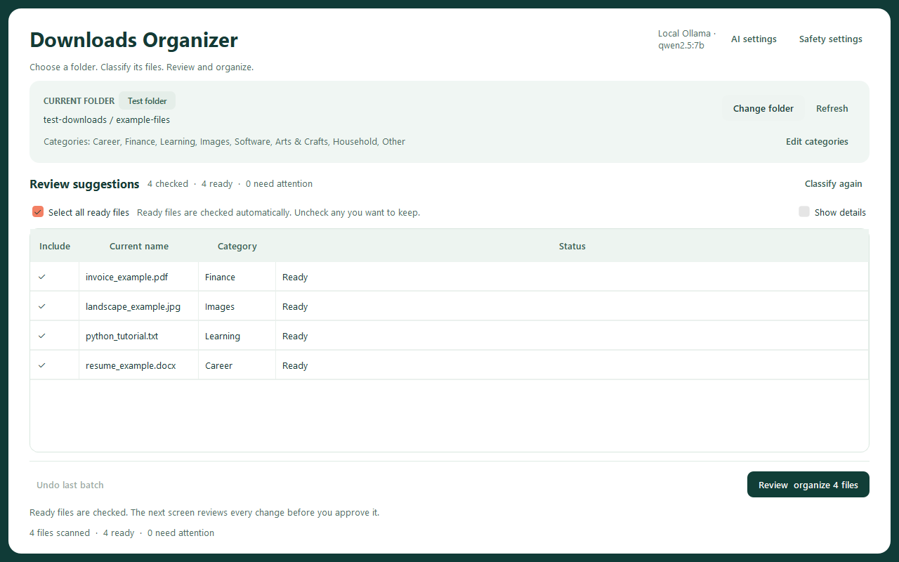
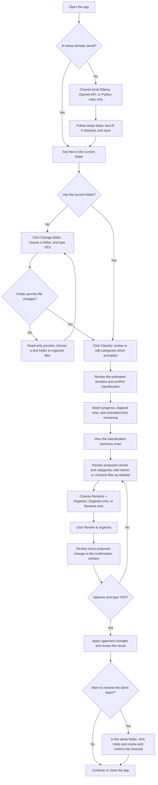

# Hybrid Downloads Organizer



*The current PySide6 interface with synthetic example files and edited name
suggestions. No personal files are shown.*

Run the modular desktop application from PowerShell:

```powershell
cd path\to\downloads-organizer
.\.venv\Scripts\Activate.ps1
python -m pip install -r requirements.txt
python downloads_organizer.py
```

## How to use the app

Follow this flow from opening the app to reviewing and approving changes.
Classifying files only proposes names and categories; it does not move or rename
them. Ready files are checked automatically, so you do not need to select every
row yourself.



If you cancel first-time setup, the app uses Python rules only for that session
and asks again next launch. OpenAI asks for consent before each classification
run that sends document information. Files with unresolved classifications or
safety issues cannot be included in an operation; review their status first.
The app starts safely in `test-downloads`. Other eligible local folders can be
approved for file changes as described below. The real Windows Downloads folder
is still blocked.

On first launch, an **AI setup** dialog offers local Ollama, the OpenAI API, or
Python rules only. This choice can be changed later with **AI settings** in the
window header. Cancelling first-run setup temporarily uses rules only and asks
again next launch. The app creates its default test folder if needed.

For local AI, check the installation, install/start Ollama if necessary, choose
or download a model, then test it with sample text. Model downloads run inside
the app with progress and cancellation; retrying reuses downloaded layers.
The official Windows installer opens its own window after download and publisher
signature verification. Nothing is installed until you request it. Existing
local models can be reused. Ollama cloud models are blocked by the local option.

For OpenAI, enter a supported model ID and your own API key, review the data and
cost explanation, and test access with sample text before saving. The key is
stored in Windows Credential Manager. The non-secret provider settings are in
`ai_settings.json`, which is ignored by Git. Each cloud classification run asks
permission before sending limited excerpts/filenames and category names. There
is no automatic switch to cloud when a local request fails. AI cache keys include
the provider, model and adapter version; old cache records remain intact.

Development data remains in the project folder. Packaged builds use
`%LOCALAPPDATA%\Downloads Organizer` for data/settings and the default test folder.

The application starts in `test-downloads`. Use **Change folder** to select
another folder. For an eligible external folder, choose **Yes** to enable
classification and approved file changes, **No** for read-only preview, or
**Cancel** to keep the current folder. Review the warning and type exactly
`YES` to switch. Writable external folders must be on a fixed local NTFS drive;
system/application folders, hidden folders, known cloud-sync locations, network
and removable drives, links and junctions are excluded. Choose a dedicated data
folder and back up important files before using it. The real Windows Downloads
folder remains blocked pending its separate authorization.

An additional safety rule requires writable external target folders to be named
**Downloads** by default, regardless of the parent path. Matching ignores letter
case and checks the selected folder itself, not its parents or category
subfolders. Other names are available only for read-only preview. Use **Safety
settings** in the header to change this required name: the app shows a warning
and requires exact typed `YES` before saving. Changing it clears existing folder
approvals and suggestions. To Undo operations in an old folder, restore its
required name and approve the folder again. Settings do not rename folders.
This rule adds to the existing safeguards; it does not unlock the real Windows
Downloads folder or system locations. The developer `test-downloads` sandbox is
exempt so regression tests and learning examples remain available.

The name is saved locally in ignored `safety_settings.json`, separately from AI
settings and credentials. If that file is invalid, external writes are blocked
until a valid name is saved in **Safety settings**. Databases and classifications
are preserved when the name changes.

Writable-folder approval lasts only for the current app session and only for
the selected folder, not all its subfolders. On a later launch, select and approve
it again. Only immediate files are scanned; category folders are not recursively
organized. Read-only preview lists files and applies filename rules without
content extraction, AI calls, cache writes, file changes or Undo. The selected path and
mode (**Test folder**, **Approved folder**, or **Read-only preview**) are shown in
the window. Folder actions (**Change folder**, **Refresh** and
**Edit categories**) are grouped in the folder card. On opening a test folder,
the app lists its files. The main action at the bottom right is **Classify**.
Click it to review five starter categories (editable per folder), then review
the estimated duration and confirm classification. The confirmation counts files
that can use Python rules/cache, unique files requiring AI, and duplicate copies
that can reuse results. OpenAI data consent is included in this confirmation when
needed. Cancelling does not start new analysis. The app then runs Python rules
and the configured AI provider for files that need it. In
rules-only mode, ambiguous files remain unresolved. The table shows the proposed
name and category. While AI is working, an animated spinner remains active,
and a progress bar advances as AI batches are checked. Elapsed time and an
estimated remaining time range update every second. Initial estimates are rough
heuristics; successful batches improve estimates for that provider/model during
the current session. They are not saved to disk. Hardware, model loading,
document complexity and network speed affect duration. If an estimate is exceeded,
the UI explicitly says the task is taking longer; it does not promise completion
at zero. Rules/cache-only runs generally finish too quickly to need a countdown.
When classification
finishes, a chart shows Python-rule results, AI results (including cached AI),
and unresolved files. Ready files are checked by default; use the checkboxes or
**Select all ready files** to adjust the selection. The main action becomes
**Review & organize**, showing the checked file count; it opens a scrollable
list of changes before confirmation. The organization mode is next to that
button. Click a row to enable **Edit suggested name** above the table. Use
**Show details** to see destinations, classification sources and duplicate counts.
Use **Edit
categories** to change a folder's list; `Other`
is required for uncertain files. Category changes cause the app to use a
different cache policy; earlier results remain in the database.

`classification_cache.db` and `operation_history.db` are
shared across these folders. On the first start after the rename, the app copies
the old `organizer_cache.db` and `step10_operations.db` to these new names if
needed; it leaves the old databases in place as backups. The backups do not
receive later updates. Check files and review the proposed changes
before confirming any operation. Undo targets the latest completed batch in
the currently selected folder and shows its recorded paths for review.
Use **Edit suggested name** to change a test-file suggestion; the original
extension is required and collisions are checked again in preview.
If an operation is marked pending,
inspect both paths and the operation history before deciding how to recover.
Do not edit the history database without first backing it up.

The supported interface uses PySide6. The prior Tkinter interface is retained
for development comparison at `downloads_organizer_tk.py`; it uses the original
local-only configuration and does not implement the new setup wizard. The original
Step 10 script is preserved in `tests/reference/` as a historical backup used
by the classification-policy comparison test; it is not the app launcher.
The modular application separates settings and classification policy
(`organizer/config.py`), rules and Ollama (`classifier.py`), cache (`cache.py`),
file operations and history (`file_manager.py`), and the desktop interface
(`qt_interface.py` and the older `interface.py`).
Provider adapters and onboarding live in `providers.py`, `ai_settings.py`,
`ai_setup_tasks.py`, and `ai_setup_dialog.py`.

Earlier application versions and learning notebooks may be retained locally
under `archive/`. They are excluded from Git because saved notebook outputs can
contain private document text and local paths. Databases, downloaded files,
action logs, credentials and local settings are also excluded from Git.

Run the regression tests without installing anything else:

```powershell
python -B -m unittest discover -s tests -v
```

Tests create temporary files and databases inside `test-downloads`. The unit
tests simulate hard links, setup/download tasks, credential storage and API
responses. They never install Ollama or call a paid API. To additionally run an opt-in
end-to-end check with the configured Ollama model, a real hard-link move, and
Undo after reopening the PySide6 window, start Ollama and run:

```powershell
python -B tests\manual_qt_workflow.py
```

This check creates and removes a disposable test folder and uses separate
databases. It automatically approves its own test operation; normal app
operations still require your confirmation.

With Ollama and the local model already installed, verify the setup dialog's
real detection, sample-text test and temporary settings persistence with:

```powershell
python -B tests\manual_ai_setup.py
```

This does not download/install software, store an API key, or call OpenAI.

To repeat the external-folder smoke test on Windows:

```powershell
python -B tests\manual_external_workflow.py
```

It creates and removes a disposable sibling folder outside the checkout, uses
isolated databases inside `test-downloads`, and automates its own confirmations.
It exercises the actual Windows move engine, folder-specific categories, and
Undo after reopening. It does not use personal files or call AI.
